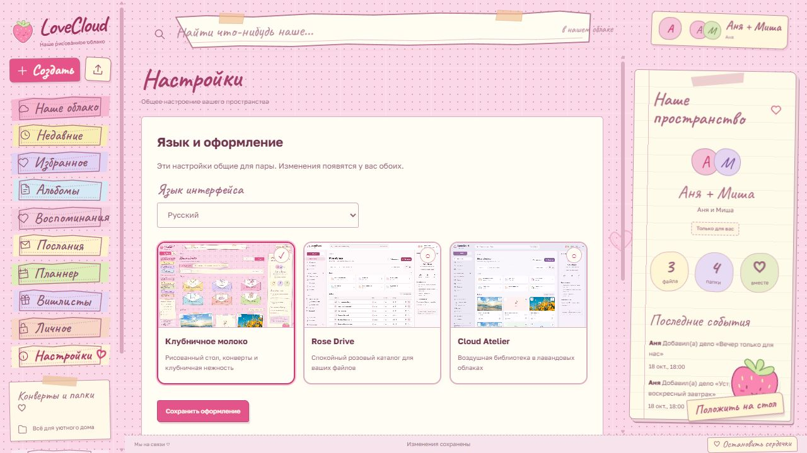
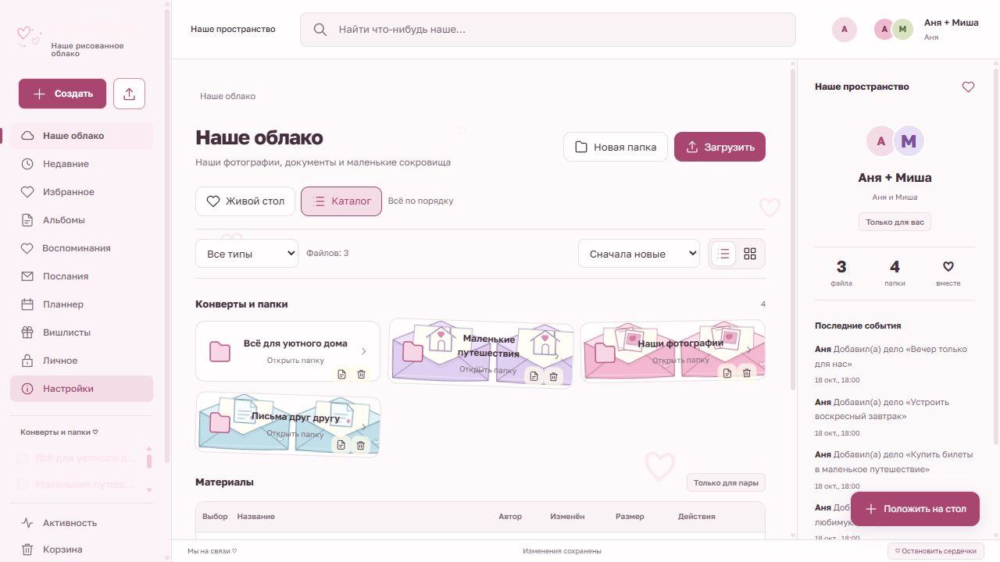

<p align="center">
  
</p>

<p align="center">
  <strong>Ваши воспоминания, маленькие планы и большие чувства — в одном облаке.</strong><br>
  Self-hosted решение от команды <strong>neo_mei</strong> для любящих сердец.
</p>

<p align="center">
  <a href="#preview">Заглянуть внутрь</a> ·
  <a href="#start">Поселиться в облаке</a> ·
  <a href="docs/SELF_HOSTING.md">Гайд по размещению</a> ·
  <a href="docs/COMMIT_STYLE.md">Письма в историю проекта</a>
</p>

<p align="center">
  <code>Next.js</code> &nbsp; <code>C# / ASP.NET Core</code> &nbsp; <code>PostgreSQL</code> &nbsp; <code>Docker</code><br>
  🍓 Три темы &nbsp; 💌 Два любящих человека &nbsp; 🌍 Русский / English
</p>

---

## Маленькое место для большого «мы» ♡

LoveCloud — личное пространство одной пары на собственном сервере.
Здесь фотографии живут в бумажных конвертах, послания складываются в ленту,
а рядом с общими делами всегда найдётся место маленькому желанию.

Можно хранить целую историю отношений — или оставить короткое «я рядом».
Своё облако вы размещаете сами, а его название, аватарки и настроение выбираете вдвоём.

<a id="preview"></a>

## Загляните в наше облако 🍓

<p align="center">
  <a href="docs/assets/cloud.jpg"></a>
  <br><sub>Клубничное молоко — рисованный стол, бумажные конверты и плавающие сердечки.</sub>
</p>

<table>
  <tr>
    <td width="50%"><a href="docs/assets/feed.jpg"></a></td>
    <td width="50%"><a href="docs/assets/planner.jpg"></a></td>
  </tr>
  <tr>
    <td align="center"><strong>💌 Сказать что-нибудь тёплое</strong><br><sub>Своя маленькая социальная лента.</sub></td>
    <td align="center"><strong>🗓️ Запланировать наше «вместе»</strong><br><sub>От любимой пасты до большого путешествия.</sub></td>
  </tr>
  <tr>
    <td><a href="docs/assets/wishes.jpg"></a></td>
    <td><a href="docs/assets/themes.jpg"></a></td>
  </tr>
  <tr>
    <td align="center"><strong>🎁 Беречь маленькие желания</strong><br><sub>И тихонько готовить сюрпризы.</sub></td>
    <td align="center"><strong>🎀 Выбрать своё настроение</strong><br><sub>Три оформления одного пространства.</sub></td>
  </tr>
</table>

<sub>Все скриншоты сняты в отдельной демо-установке. Имена, записи и иллюстрации вымышлены; личные данные не использовались. Изображения открываются в полном размере по нажатию.</sub>

## Что поселится внутри

| Для ваших… | Что умеет LoveCloud |
| --- | --- |
| 📷 **Воспоминаний** | Настоящие файлы, вложенные папки, альбомы, поиск, избранное и недавние. Сетка, список и рисованный стол. |
| ✉️ **Маленьких сокровищ** | Конверты объединяют выбранные материалы без копирования оригиналов. Корзина позволяет вернуть удалённое в течение 30 дней. |
| 💌 **Слов друг другу** | Социальная лента с публикациями, фотографиями, ответами, сердечками и закреплениями. Обновления приходят через SignalR. |
| 🗓️ **Общих планов** | Список, неделя и канбан. Даты, ответственные, приоритеты и повторяющиеся дела. |
| 🎁 **Желаний и сюрпризов** | Вишлист каждого партнёра: заметки, ссылки и цены. Подарок можно зарезервировать, и автор желания этого не увидит. |
| 🔐 **Самого личного** | Отдельное хранилище с TOTP через Google Authenticator или совместимое приложение, QR, recovery codes и временным доступом. |

Ещё немного нежности: общая аватарка пары, личные аватарки, русский и английский
интерфейс, локальные шрифты, мобильная раскладка и возможность остановить анимации.

### Три настроения одного дома

| 🍓 Клубничное молоко | 🌷 Rose Drive | ☁️ Cloud Atelier |
| --- | --- | --- |
| [](docs/assets/cloud.jpg) | [](docs/assets/rose-drive.jpg) | [](docs/assets/cloud-atelier.jpg) |
| Рисованный стол, клубничные оттенки и конверты. | Спокойный розовый каталог с аккуратной навигацией. | Воздушная лавандовая библиотека с мягкими карточками. |

Язык, тему и аватарки можно менять после установки. Ваши материалы останутся на месте.

<a id="start"></a>

## Поселиться в облаке 🏡

Нужны **Docker Engine / Docker Desktop и Docker Compose v2**.
Node.js и .NET на сервере устанавливать не требуется.
Скачайте исходники и откройте терминал в папке проекта.

**Windows · PowerShell**

```powershell
./scripts/init.ps1 -Start
```

**Linux / macOS · shell**

```sh
sh scripts/init.sh --start
```

На Linux / macOS для генерации секретов нужен `openssl`.

Установщик поднимет Docker и выдаст личную одноразовую ссылку:

```text
http://localhost:3211/setup#token=<ваш-одноразовый-секрет>
```

Откройте её и пройдите маленькие шаги к общему дому:

1. Выберите **Русский / English**.
2. Придумайте название пары, добавьте дату вашей истории и аватарку.
3. Создайте свой аккаунт и аккаунт второй половинки.
4. Выберите оформление и отдельный пароль администратора.
5. Откройте своё пространство. Первые воспоминания ждут вас. ♡

В облаке ровно **три аккаунта**: администратор и два партнёра.
Открытой регистрации нет. Второй партнёр меняет первоначальный пароль при первом входе.
После завершения одноразовая ссылка закрывается навсегда.

Новая установка пустая: фотографии и записи со скриншотов автоматически не добавляются.

<details>
<summary><strong>Письмо потерялось? Где найти ссылку и как продолжить установку</strong></summary>

Ссылка сохранена в `.secrets/setup-link.txt`. Не публикуйте её или содержимое `.secrets/`.
Перезагрузка страницы сохраняет setup-сессию браузера; поля и пароли потребуется ввести заново.

Если до завершения установки потерян доступ к этому браузеру, выдайте новый секрет:

```powershell
./scripts/init.ps1 -ResetSetupToken -Start
```

```sh
sh scripts/init.sh --reset-setup-token --start
```

Новый секрет не открывает уже настроенное облако заново.
Подробности — в [гайде по размещению](docs/SELF_HOSTING.md).

</details>

## Ваш сервер, ваши воспоминания 🔐

По умолчанию облако доступно на `http://localhost:3211` только с вашего компьютера.
Для доступа вдвоём разместите его на своём сервере через
[собственный HTTPS-домен](docs/SELF_HOSTING.md#https) или [Tailscale](docs/TAILSCALE.md).

TOTP защищает вход в личный раздел. Это серверная модель хранения: владелец сервера
имеет доступ к диску и ключам; сквозного шифрования E2EE нет.
База, файлы и ключи сохраняются в постоянных Docker-томах.

Файлы — до **5 GiB**, общая квота — **100 GiB**, личный раздел — до **20 GiB**.
Приложение пока не делает отдельные миниатюры, видеотранскодирование и возобновляемые загрузки по частям.
Видео и аудио воспроизводятся при поддержке формата браузером.

**Берегите резервные копии.** [Как обновлять, сохранять и восстанавливать облако →](docs/SELF_HOSTING.md#backups)

## Из чего соткано облако 🧵

```text
Браузер пары
    ↓
nginx / HTTPS
    ├── Next.js · React · TypeScript
    └── ASP.NET Core · C# · SignalR
              ├── PostgreSQL
              ├── файлы
              └── ключи DataProtection
```

| Часть | Стек |
| --- | --- |
| Интерфейс | Next.js 16, React 19, TypeScript, SWR |
| Сервер | C# / ASP.NET Core 10, Entity Framework Core, SignalR |
| Данные | PostgreSQL 18, файловое хранилище, постоянные Docker-тома |
| Размещение | Docker Compose, nginx, опционально Caddy или Tailscale |

Это пространство **одной пары**. Многоарендности и публичной регистрации в нём нет.

## Добавить облаку немного любви 💌

Есть идея, нашли ошибку или хотите помочь? Загляните в [CONTRIBUTING.md](CONTRIBUTING.md).
Изменения интерфейса сопровождаем скриншотами, а новые возможности — понятным описанием.

В истории проекта оставляем маленькие, содержательные письма:

```text
feat(feed): 💌 add replies to love notes
fix(vault): 🩹 close access when the session expires
style(cloud): 🎀 draw envelopes for shared albums
docs(readme): 💐 share our little world
```

[Полный гайд по коммитам](docs/COMMIT_STYLE.md) · [Визуальный стиль](docs/BRAND.md) · [API](docs/API.md)

---

<p align="center">
  <strong>С любовью, команда neo_mei ♡</strong><br>
  <sub>Чтобы у каждого «мы» был свой маленький дом.</sub>
</p>
