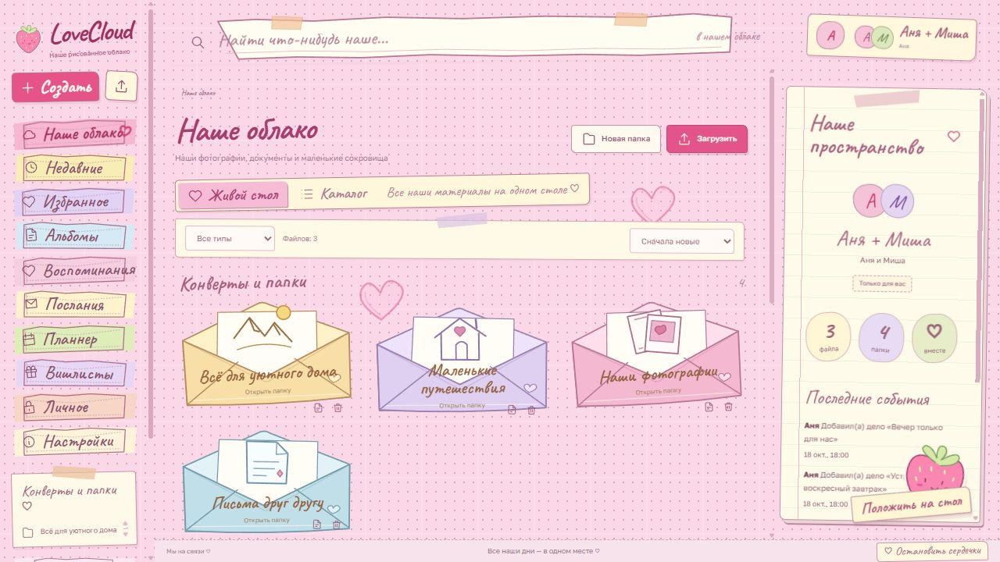
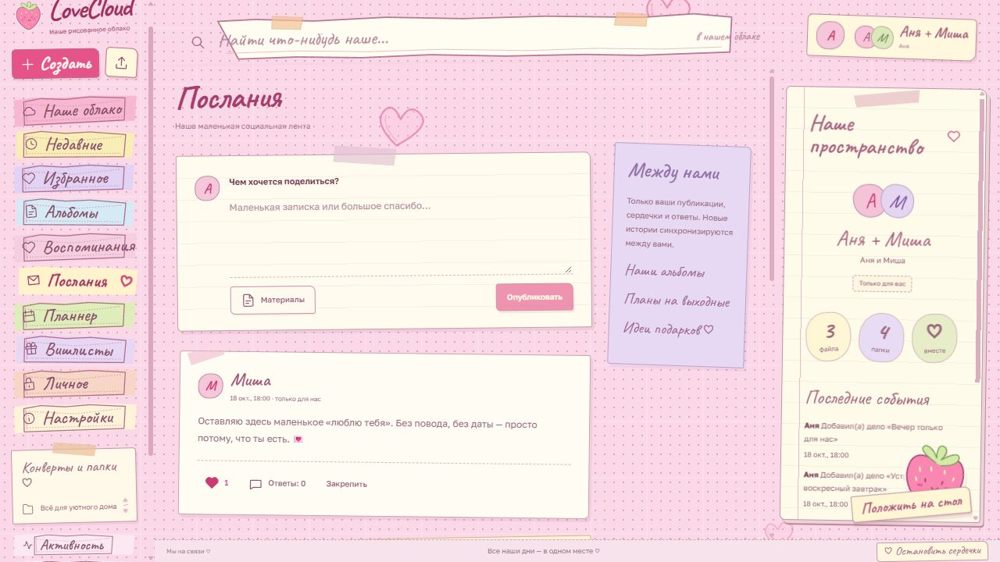
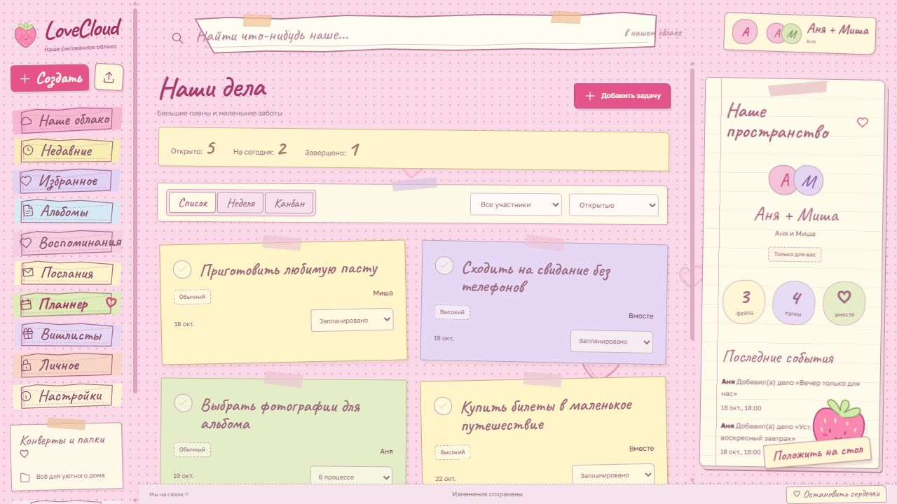
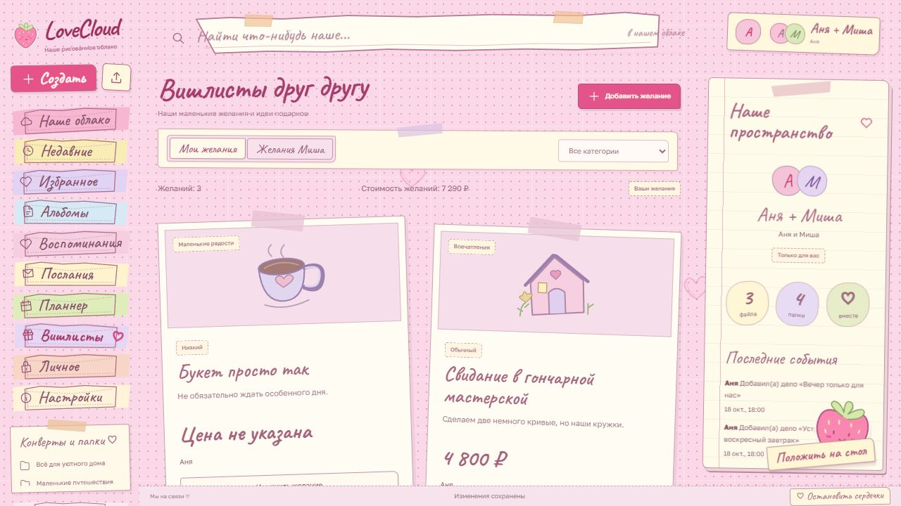
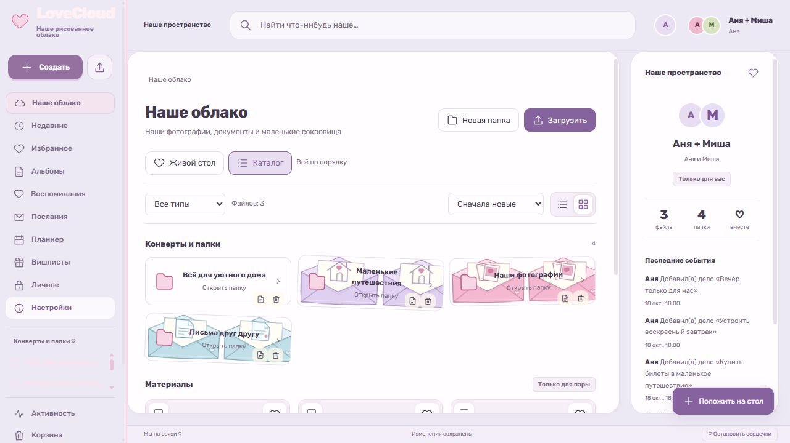

<p align="center"></p>
<p align="center"><strong>Ваши воспоминания, маленькие планы и большие чувства — в одном облаке.</strong><br>Self-hosted решение команды <strong>neo_mei</strong> для любящих сердец.</p>
<p align="center"><a href="README.md">English</a> · <a href="https://m0rp3x.github.io/LoveCloud/">Интерактивный предпросмотр</a> · <a href="https://github.com/m0rp3x/LoveCloud/releases/tag/v0.1.0">Установить v0.1.0</a> · <a href="docs/SELF_HOSTING.md">Гайд по размещению</a></p>



**v0.1.0 — ранний выпуск для одной пары на одном сервере.** Основная платформа — Linux amd64. Нет E2EE, возобновляемых загрузок и настоящих миниатюр. Перед личными материалами прочитайте [модель доступа и ограничения](docs/LIMITATIONS.md).

## Маленькое место для большого «мы» ♡

LoveCloud объединяет файлы, социальную ленту, планы и вишлисты в пространстве, которое вы размещаете сами. Бумажные конверты и плавающие сердечки превращают привычное облако в ваш стол. Выбирайте «Клубничное молоко», Rose Drive или Cloud Atelier. Полное приложение говорит на русском и английском.

**[Попробовать интерактивный предпросмотр](https://m0rp3x.github.io/LoveCloud/)** можно без регистрации. Это статический прототип: вымышленная пара, изменения в памяти каждой вкладки, имитация загрузки и проверки кода. Сервера и синхронизации двух пользователей в предпросмотре нет. Полное приложение устанавливается отдельно.

| Для ваших… | Что умеет установленное приложение |
| --- | --- |
| 📷 Воспоминаний | Настоящие файлы, вложенные папки, альбомы, поиск, избранное, недавние, стол/сетка/список. |
| ✉️ Маленьких сокровищ | Конверты упорядочивают материалы, альбомы ссылаются на оригиналы. Корзина сохраняет удалённое до истечения 30 дней. |
| 💌 Слов друг другу | Социальная лента с вложениями, ответами, сердечками, закреплениями и обновлениями SignalR. |
| 🗓️ Общих планов | Список, неделя, канбан, ответственные, сроки, приоритеты и повторяющиеся дела. |
| 🎁 Желаний | Личный вишлист каждого, заметки, ссылки, цены. Резерв подарка скрыт от автора желания. |
| 🔐 Личного | Общая защищённая область, отдельный TOTP каждого партнёра, recovery codes, временный доступ. |

<table><tr><td></td><td></td></tr><tr><td></td><td></td></tr></table>

Скриншоты сняты в отдельной синтетической установке. Личных материалов пары нет. [Происхождение изображений](docs/assets/README.md).

## Поселиться в облаке 🏡

Скачайте **lovecloud-v0.1.0-install.tar.gz** или **.zip** из [релиза](https://github.com/m0rp3x/LoveCloud/releases/tag/v0.1.0), проверьте SHA-256, распакуйте и откройте терминал в каталоге. Обычная установка скачивает готовые Docker-образы, закреплённые по digest. Git, Node.js и .NET SDK не требуются.

Нужны Docker Engine либо Docker Desktop с Linux-контейнерами, Compose v2.24.4 или новее, поддерживаемая оболочка и доступ к реестрам образов. Shell-установщику нужен `openssl`, PowerShell — версии 7. Проверяемая платформа выпуска — **linux/amd64**. Нативная поддержка arm64/macOS не заявлена.

```sh
sh scripts/init.sh --start
```

```powershell
./scripts/init.ps1 -Start
```

Установщик дождётся готовности и выдаст одноразовую ссылку. Она также лежит в `.secrets/setup-link.txt`; не публикуйте её. В мастере выберите RU/EN, название пары, дату, часовой пояс, аватарки, два аккаунта, тему и пароль администратора. Первый партнёр входит сразу, второй меняет первоначальный пароль при первом входе. Ровно **три аккаунта: администратор и два партнёра**. После завершения мастер не открывается повторно. Новое облако пустое: демо-данные не добавляются.

По умолчанию доступ только с этого компьютера: `http://localhost:3211`. Для доступа вдвоём настройте [HTTPS](docs/SELF_HOSTING.md#https) либо [Tailscale](docs/TAILSCALE.md). HTTP предназначен для локального использования, не публикуйте его напрямую в интернет.

## Беречь воспоминания

Оператор сервера имеет доступ к данным и ключам. TOTP — дополнительная проверка доступа приложения, **не сквозное шифрование**. Сохраняйте зашифрованную копию БД, файлов и аватарок, DataProtection keys, секретов и фактической конфигурации вне сервера. Пароль копии храните отдельно.

[Установка](docs/SELF_HOSTING.md) · [Первоначальная настройка](docs/SETUP.md) · [Обновление](docs/UPDATE.md) · [Backup и восстановление](docs/BACKUP_RESTORE.md) · [Диагностика](docs/TROUBLESHOOTING.md)

## Из чего соткано облако 🧵

Next.js / React / TypeScript, nginx, ASP.NET Core 10 / SignalR, PostgreSQL 18 и постоянные тома файлов/ключей. Один процесс API выполняет обновления и фоновую очистку. [Архитектура и данные](docs/ARCHITECTURE.md) · [API](docs/API.md) · [Разработка из исходников](docs/DEVELOPMENT.md).

## Добавить немного любви 💌

[Участие](CONTRIBUTING.md) · [Романтичные английские коммиты](docs/COMMIT_STYLE.md) · [Планы](ROADMAP.md) · [История](CHANGELOG.md) · [Приватное сообщение об уязвимости](SECURITY.md)

```text
feat(feed): 💌 add replies to love notes
fix(vault): 🩹 close access when the session expires
docs(readme): 💐 welcome loving hearts
```

## Лицензия

Собственный код LoveCloud распространяется по [Apache-2.0](LICENSE). Шрифты, зависимости и компоненты образов сохраняют собственные лицензии: [THIRD_PARTY_NOTICES](THIRD_PARTY_NOTICES), [аудит](docs/LICENSING_AUDIT.md), SBOM и комплект уведомлений точных образов приложены к релизу. Дополнительного запрета коммерческого использования, обязательных платежей и требования присылать изменения через PR нет.

<p align="center"><strong>С любовью, команда neo_mei ♡</strong><br><sub>Чтобы у каждого «мы» был свой маленький дом.</sub></p>
