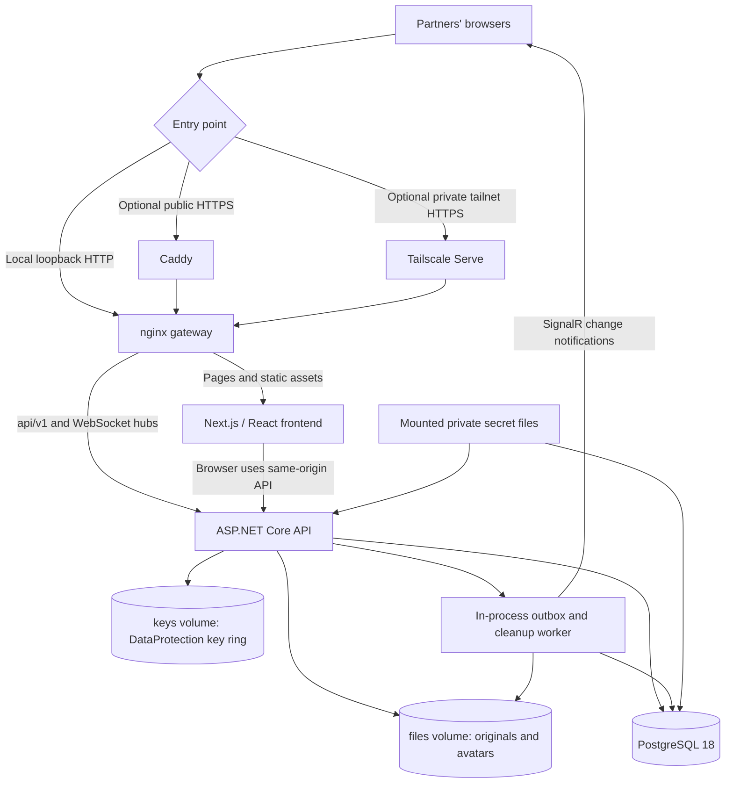

# The home behind the paper envelopes

LoveCloud v0.1.0 is one self-hosted instance for one pair. It runs a single ASP.NET Core API process. The static GitHub Pages preview is separate and has no connection to this stack.

## Responsibilities

nginx routes frontend pages, authenticated HTTP API and SignalR through one origin. Optional Caddy or Tailscale terminates HTTPS; database ports remain private. Next.js renders the interface and serves its assets. Authentication, roles, CSRF, file authorization, TOTP, quotas and gift-reservation visibility are enforced by the API, not by drawings or hidden buttons.

PostgreSQL stores pair/accounts, sessions, setup state, metadata, posts/replies, tasks, wishes, audit records and a transactional outbox. Originals are stored on disk under generated blob identifiers, not inside PostgreSQL. Avatar uploads are decoded and normalized to PNG. DataProtection protects stored TOTP secrets using the persisted key ring; this is not E2EE.

The **in-process OutboxWorker** polls the DB, revalidates live sessions, emits SignalR invalidations and removes delivered outbox rows. It also runs periodic storage/avatar cleanup: expired sessions, 30-day trash, abandoned staging and sufficiently old orphan blobs/pending avatars. There is no separate queue broker, transcoding service or thumbnail worker.

## Data to back up

| Location | Contents | Recovery implication |
| --- | --- | --- |
| PostgreSQL `pgdata` mount | All relational state | Preserve major version and consistent DB dump. PostgreSQL 18 uses `/var/lib/postgresql`. |
| API `/data/files` mount | Shared/vault originals, avatars, staging | Restore with matching metadata; full file hashes verify originals. |
| API `/data/keys` mount | DataProtection keys | Required to decrypt existing TOTP secrets. |
| `.secrets/` | DB/bootstrap/setup secrets | Required to reproduce the installation; keep private. |
| `.env`, Compose files and overrides, `ops/` | Effective origin, cookies, project and mount topology | Required to attach the same volumes and use the right origin. |
| Optional Caddy/Tailscale state | Certificates / tailnet identity and Serve config | Do not clone a live Tailscale identity into a second online node. |
| Separate backup password | Key to encrypted backup repository | Store separately; excluded from its own backup. |

Volume names are illustrative: custom `COMPOSE_PROJECT_NAME`, `-p` and explicit volume overrides change actual names. Operational scripts inspect running mounts; do not reconstruct names from a hard-coded `lovecloud_` prefix.

## Current boundaries

Only one API replica is supported. Connection tracking and worker scheduling have process-local state; multiple replicas need an architectural change and validation. Horizontal scaling, S3, real thumbnails, resumable uploads and video processing are future tasks, not dormant features. [LC-001](../ROADMAP.md) addresses thumbnails first.

See [limits and access](LIMITATIONS.md) and [recovery](BACKUP_RESTORE.md).
